# donaldbough-personal-website

Fun personal website where I'm experimenting working with GPUs through shaders, WebGL, and ThreeJS on a video game like experience in your browser.

The site is a neon, magenta-and-cyan cyberpunk first-person laboratory ("Lab 07"), built with vanilla JavaScript and [Three.js](https://threejs.org/) using the `WebGPURenderer` (it falls back to WebGL2 automatically when WebGPU isn't available).

No bundler, no build step, no backend: Three.js r187 is vendored unmodified in `vendor/three/` under the MIT license and loaded through an [import map](https://developer.mozilla.org/en-US/docs/Web/HTML/Element/script/type/importmap) in `index.html`. To upgrade, download the `three` npm tarball and replace the files in `vendor/three/` that the import map and addons use.

## Running locally

ES modules need to be served over HTTP (opening `index.html` directly from disk won't work). Any static file server works, for example:

```sh
python3 -m http.server 8080
# or
npx serve .
```

Then open <http://localhost:8080>. Use a recent Chrome or Edge for WebGPU; the renderer backend in use is shown in the top-left corner.

## Controls

| Key | Action |
| --- | --- |
| Mouse | Look around |
| W A S D | Move |
| Shift | Sprint |
| E | Interact / close |
| F | Toggle flashlight |
| Esc | Pause |

On phones and tablets: drag on the left half of the screen to move, drag on the right half to look, and use the on-screen buttons to interact, toggle the flashlight and pause. Phones render at a lower resolution with smaller shadow maps to keep the frame rate up.

## Project structure

```
index.html            Page shell, HUD markup and the Three.js import map
css/style.css         HUD, overlay and inspect panel styles
src/
  main.js             Entry point: creates everything and runs the frame loop
  content.js          All personal text shown in the lab (edit me!)
  core/renderer.js    WebGPURenderer setup and resizing
  core/device.js      Touch-device detection and per-device quality settings
  input/touchControls.js  On-screen joystick, drag-to-look and buttons for touch devices
  player/
    player.js         Pointer-lock / touch look, WASD / joystick movement, collisions, head bob
    flashlight.js     Camera-mounted, shadow-casting spotlight
  interaction/
    interactions.js   Raycast from the crosshair and "[E] interact" handling
  ui/hud.js           Small wrapper around the HTML HUD elements
  world/
    lab.js            Assembles the room, lighting and props (the layout lives here)
    room.js           Floor, walls, ceiling, pipes and the door
    lighting.js       Magenta and cyan ceiling panels (one flickers), door pulse light, fog, environment
    neon.js           Neon tubes and additive glow halos (a cheap stand-in for bloom)
    textures.js       Procedural canvas textures (tiles, paint, screens, signs, photo placeholders)
    materials.js      Shared materials and a small mesh helper
    props/            One file per object: terminals, guitar, photos, Oscar, lab bench, shelf
assets/               Photos, models and audio
```

### Assets

- `photos/` contains the photos referenced by `src/content.js`.
- `models/` is for future glTF models.
- `audio/` is for future sounds.

### Adding a prop

Each prop module exports a function returning:

```js
{
  object,          // a THREE.Object3D to add to the scene
  interactables,   // [{ object, title, body, onInteract? }]
  update,          // optional (dt, elapsed, { playerPosition }) => void
  solid,           // optional: true to block the player with its bounding box
}
```

Then place it in `src/world/lab.js`.

### Adding photos

Put images in `assets/photos/` and set the `src` of an entry in `content.photos` in `src/content.js`, e.g. `src: 'assets/photos/oscar.jpg'`. Each frame resizes to its photo's aspect ratio. Before committing, shrink photos and strip their metadata (phone photos carry GPS location), e.g. `convert in.jpeg -auto-orient -resize 1024x1024\> -strip -quality 82 assets/photos/out.jpg`.

## Progress

### Milestone 1: Cyberpunk lab

The first explorable room: a magenta-and-cyan cyberpunk lab built with standard Three.js materials, lights and canvas textures (no custom shaders or post-processing yet), playable with a mouse and keyboard or touch controls on a phone. Captured on the WebGL2 fallback renderer.

#### Walkthrough

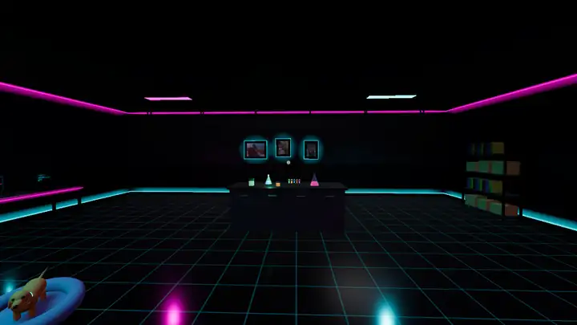

Higher quality: [walkthrough.mp4](docs/milestones/01-cyberpunk-lab/walkthrough.mp4)

#### Phone: look, move and tap to strum the guitar

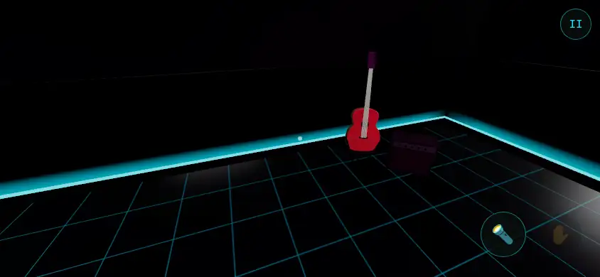

Higher quality: [mobile-tap-to-strum.mp4](docs/milestones/01-cyberpunk-lab/mobile-tap-to-strum.mp4)

#### Screenshots

| | |
|---|---|
| 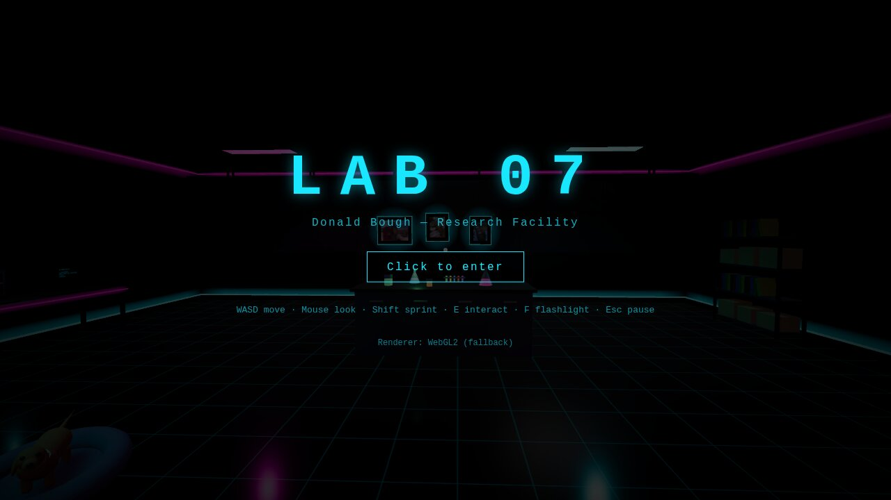 Title screen | 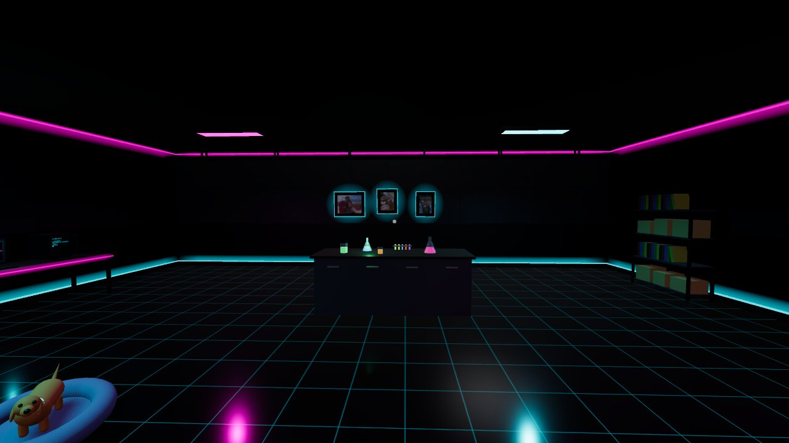 Spawn view |
| 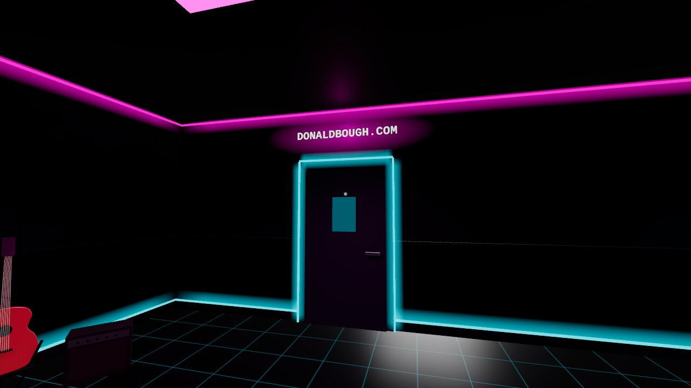 Neon sign over the door | 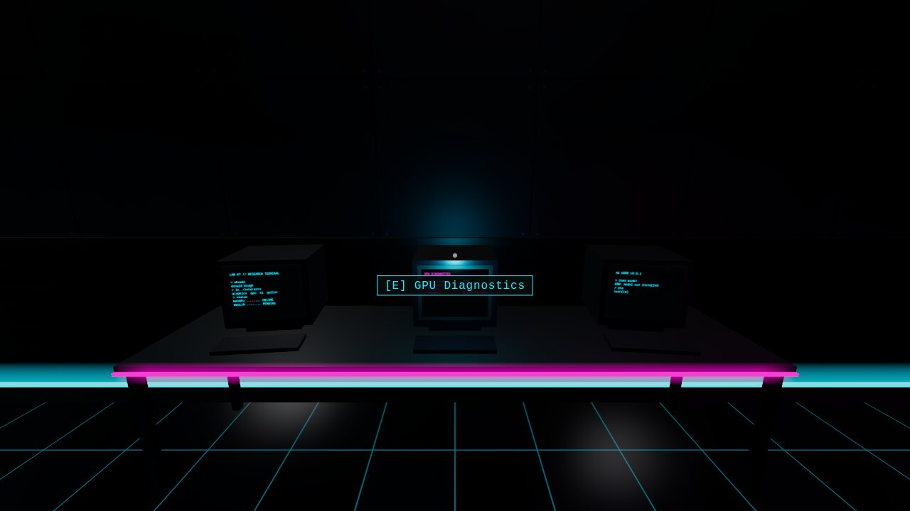 Terminals |
| 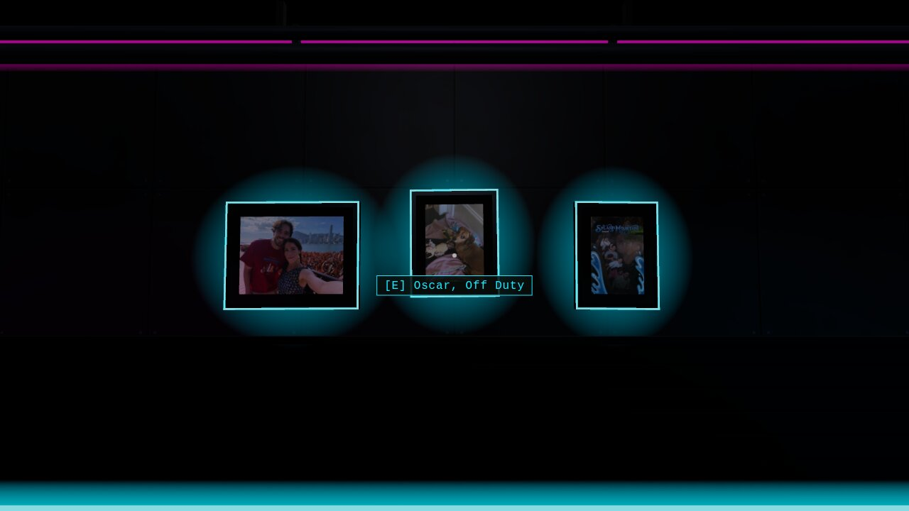 Photo wall | 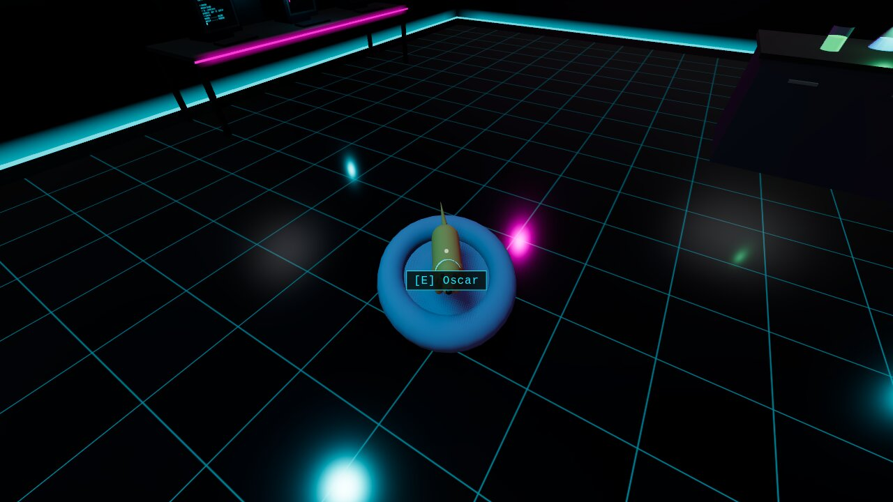 Oscar |
| 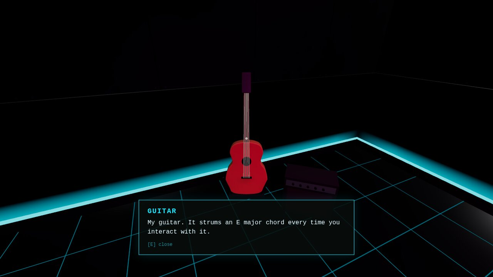 Guitar inspect panel | 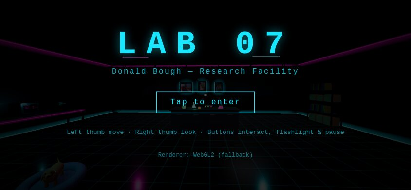 Phone title screen |
| 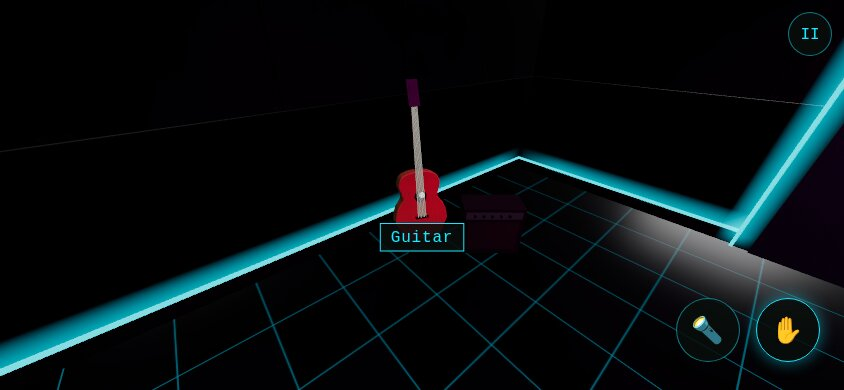 Phone: hand button lights up on a target | 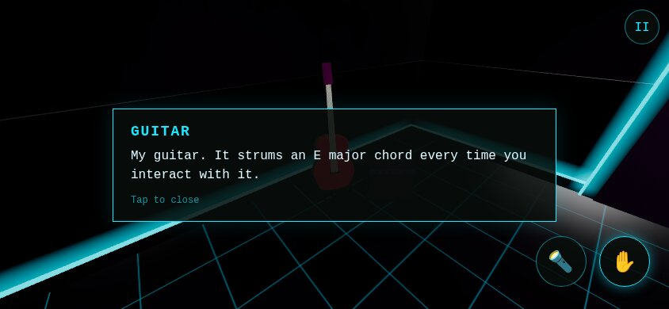 Phone: guitar inspect panel |

## Roadmap

- **Graphics:** real models (glTF), better materials, post-processing (bloom, film grain, vignette).
- **GPU programming:** compute-shader dust particles and volumetric flashlight beams in TSL / WGSL.
- **On-device AI:** an in-browser LLM via WebLLM to answer questions on the terminals and drive Oscar's behavior with tool calling.
- **Hosting:** Firebase Hosting.
