# Milestone 1: Cyberpunk lab

The first explorable room: a magenta-and-cyan cyberpunk lab built with standard Three.js materials, lights and canvas textures (no custom shaders or post-processing yet), playable with a mouse and keyboard or touch controls on a phone.

Captured on the WebGL2 fallback renderer.

## Walkthrough

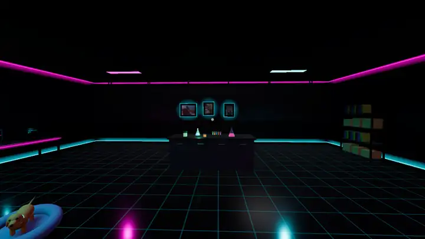

Higher quality: [walkthrough.mp4](walkthrough.mp4)

## Phone: look, move and tap to strum the guitar

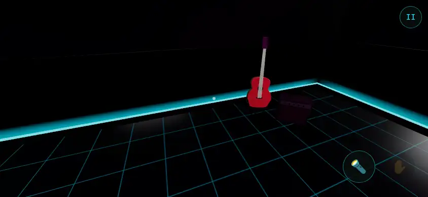

Higher quality: [mobile-tap-to-strum.mp4](mobile-tap-to-strum.mp4)

## Screenshots

| | |
|---|---|
| 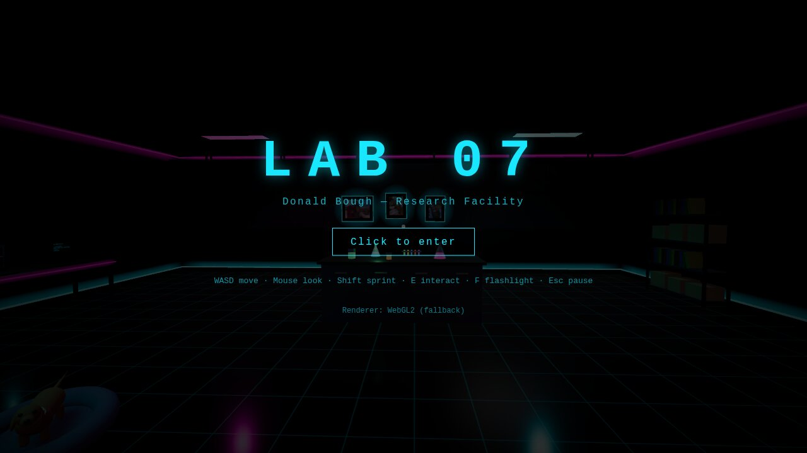 Title screen | 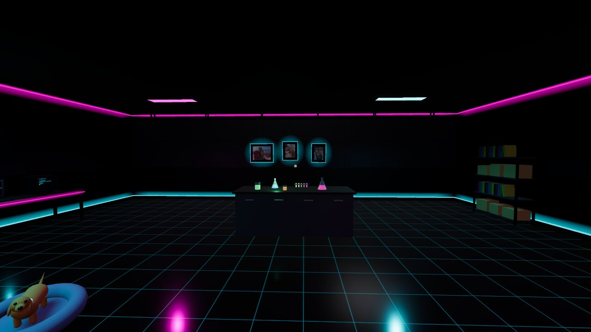 Spawn view |
| 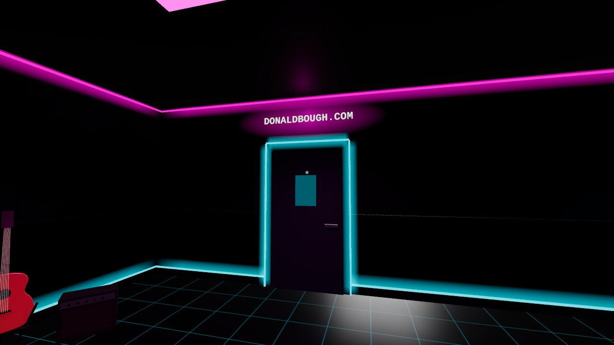 Neon sign over the door | 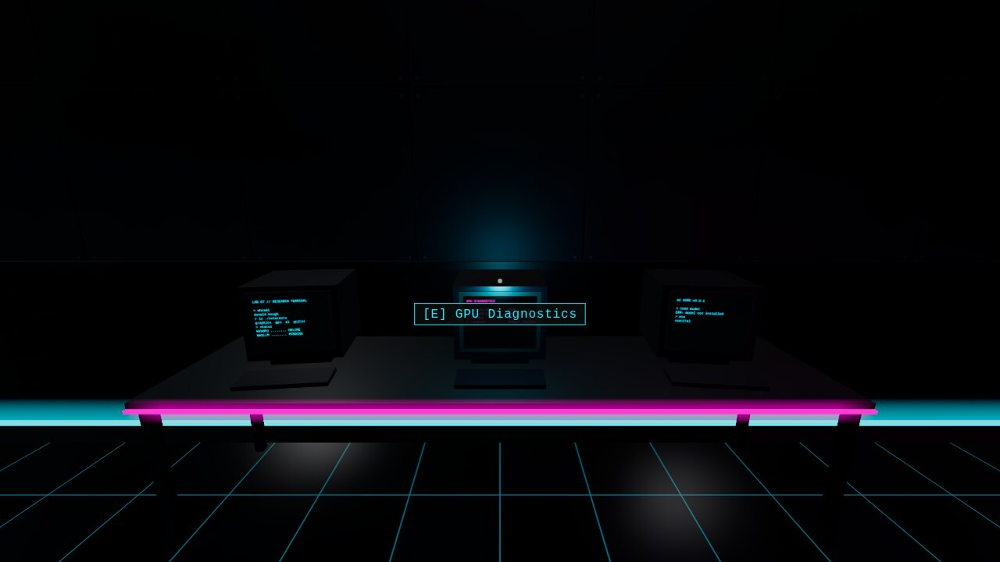 Terminals |
| 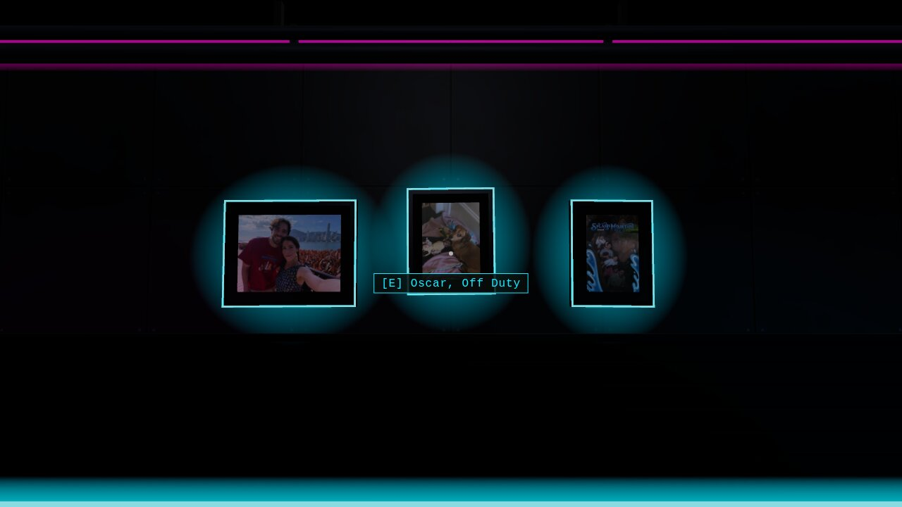 Photo wall | 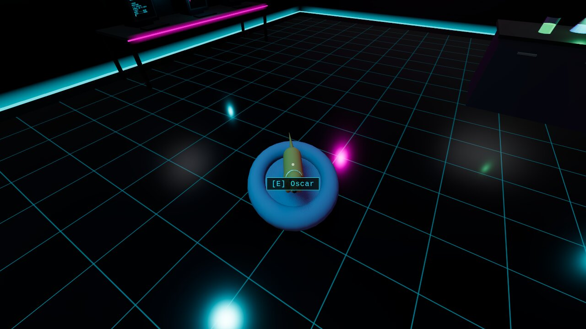 Oscar |
| 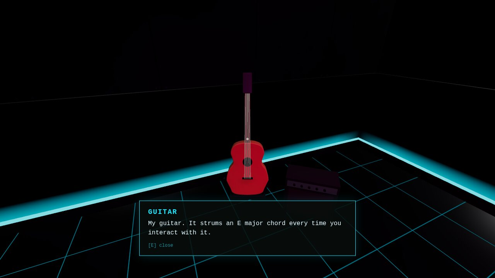 Guitar inspect panel | 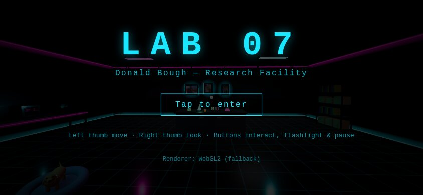 Phone title screen |
| 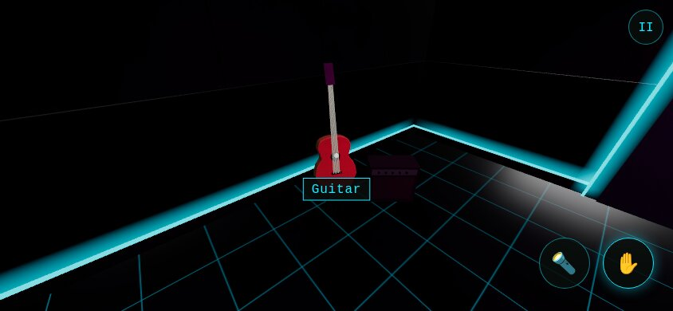 Phone: hand button lights up on a target | 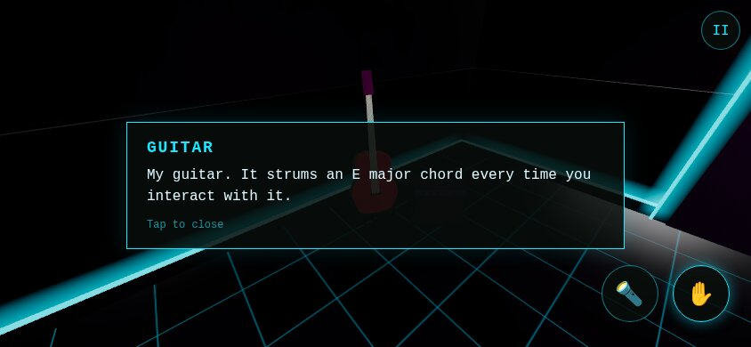 Phone: guitar inspect panel |
